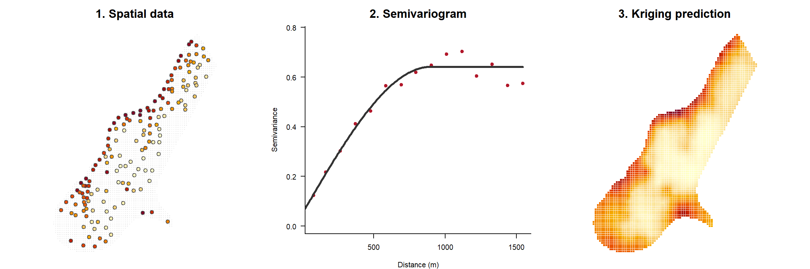

<p align="left">
  
  &nbsp;&nbsp;&nbsp;&nbsp;
  
</p>

## Análisis y Predicción Estadística de Datos Espacio-Temporales

Máster en Sistemas de Información Geográfica y Teledetección · Academic year 2026-27

**Lecturers:** Aritz Adin and Tomás Goicoa (Universidad Pública de Navarra)

---



---

### Contents

#### Chapter 3: Cokriging

|   | Description |
|---|-------|
| [Example 3.1](./Chapter3_Example1.html) | Meuse data: direct and cross-semivariograms, linear model of coregionalization |

---

### Requirements

The practical sessions use the following R packages:

```r
install.packages(c("dplyr","gstat","sf","sp"))
```

---

### References

- Bivand, R. S., Pebesma, E., & Gómez-Rubio, V. (2013). *Applied Spatial Data Analysis with R* (2nd ed.). Springer.

- Pebesma, E., & Bivand, R. (2023). *Spatial Data Science: With Applications in R*. Chapman & Hall/CRC.