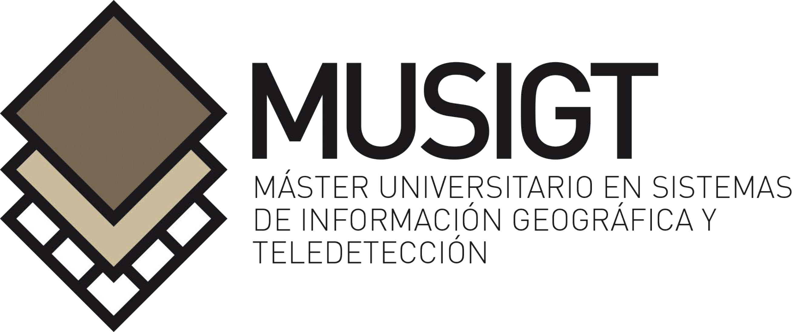

<p align="left">
  
  &nbsp;&nbsp;&nbsp;&nbsp;
  
</p>

## Análisis y Predicción Estadística de Datos Espacio-Temporales

Máster en Sistemas de Información Geográfica y Teledetección · Academic year 2026-27

**Lecturers:** Aritz Adin and Tomás Goicoa (Universidad Pública de Navarra)

---


---

### Chapter 3: Cokriging

**Examples** (guided practicals with commented code)

|   | Description |
|---|-------|
| 📘 [Example 3.1](./Chapter3_Example1.html) | Meuse data: direct and cross-semivariograms, linear model of coregionalization |
| 📘 [Example 3.2](./Chapter3_Example2.html) | Meuse data: co-kriging prediction |
| 📘 [Example 3.3](./Chapter3_Example3.html) | PENDIENTE |

**Exercises** (to be solved by the students)

|   | Description |
|---|-------|
| ✏️ [Exercise 3.1](./Chapter3_Exercise1.html) | Meuse data: co-kriging of cadmium using copper |
| ✏️ [Exercise 3.2](./Chapter3_Exercise2.html) | PENDIENTE |

---

### Requirements

The practical sessions use the following R packages:

```r
install.packages(c("dplyr","gstat","sf","sp","tmap"))
```

---

### References

- Bivand, R. S., Pebesma, E., & Gómez-Rubio, V. (2013). *Applied Spatial Data Analysis with R* (2nd ed.). Springer. [https://asdar-book.org/](https://asdar-book.org/)

- Pebesma, E., & Bivand, R. (2023). *Spatial Data Science: With Applications in R*. Chapman & Hall/CRC. [https://r-spatial.org/book](https://r-spatial.org/book)

- Tennekes M (2018). “tmap: Thematic Maps in R.” _Journal of Statistical Software_, 84(6), 1-39. <https://doi.org/10.18637/jss.v084.i06>
